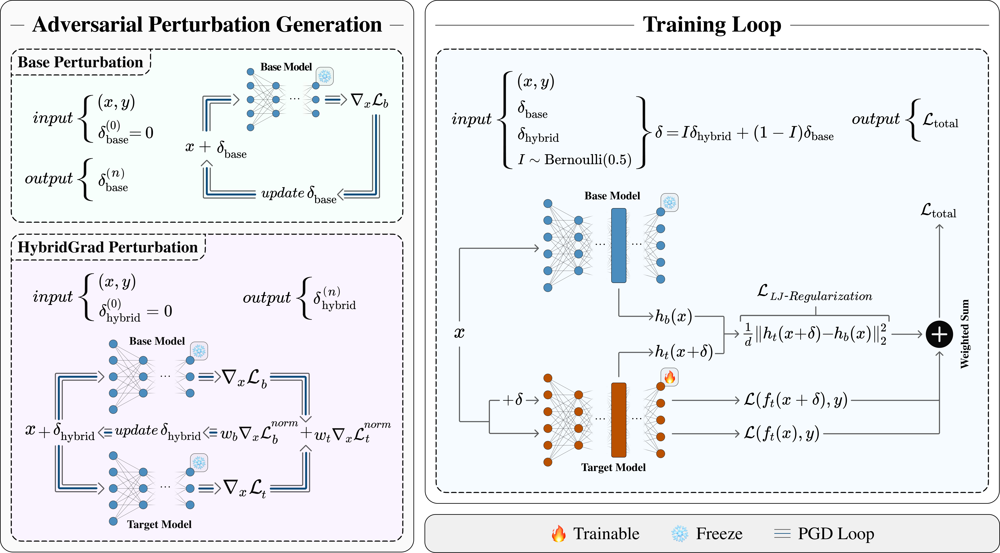

# TransferBreaker: Breaking Adversarial Transferability in Fine-Tuned Speech Recognition

Official implementation of **"Breaking Adversarial Transferability in Fine-Tuned Speech Recognition"** (NeurIPS 2026).

> **Authors:** Mojtaba Nafez<strong>\*</strong>, Aref Mousavi<strong>\*</strong>, Mohammad Ebrahim Mahdavi, Mobina Poulaei, Kiarash Kiani Feriz, Mohammad Hossein Rohban  
> <strong>\*</strong> Equal contribution.  

**Links:** Paper and BibTeX coming soon.

<p align="center">
  
</p>


## 📖 Abstract

> Many organizations fine-tune publicly available pretrained Automatic Speech Recognition (ASR) models and deploy them in black-box settings, assuming limited access provides protection. We show this assumption is fragile: adversarial perturbations crafted on the public base model transfer effectively to fine-tuned target models, severely degrading performance and posing concerns for safety-critical applications. We propose TransferBreaker, a unified fine-tuning framework that suppresses adversarial transfer by integrating Base Adversarial Fine-Tuning, which restricts adversarial training to base-effective perturbations; Latent Jacobian Regularization, which enforces latent-space invariance by suppressing adversarially sensitive directions; and HybridGrad-AFT, which improves robustness against adaptive attacks by interpolating transferable perturbations from base and target gradients. We theoretically justify all components and extensively evaluate TransferBreaker across three languages and four large ASR models, substantially reducing adversarial WER from 92.6 to 27.8.


## 🧩 Method

TransferBreaker combines three complementary components:

- **Base Adversarial Fine-Tuning (Base-AFT):** trains the target model on adversarial examples generated from the frozen public base model.
- **Latent Jacobian Regularization (LJ-Regularization):** encourages latent-space invariance by aligning the target representation of adversarial inputs with the base representation of clean inputs.
- **HybridGrad-AFT:** generates transferable perturbations using a scheduled combination of base- and target-model input gradients.

The framework is model-agnostic and is evaluated in the paper on Whisper, Wav2Vec2, and MMS backbones across Polish, Portuguese, and Arabic.


## ⚙️ Setup

Clone the repository:

```bash
git clone https://github.com/rohban-lab/TransferBreaker.git
cd TransferBreaker
```

Create a Python environment:

```bash
conda create -n transferbreaker python=3.9
conda activate transferbreaker
```

Install PyTorch and the remaining dependencies:

```bash
conda install pytorch==2.1.0 torchvision==0.16.0 torchaudio==2.1.0 \
  pytorch-cuda=11.8 -c pytorch -c nvidia
pip install -r requirements.txt
```

Adjust the PyTorch/CUDA installation to match your system if needed.


## 📁 Data Preparation

The main experiments use **[Mozilla Common Voice 24](https://commonvoice.mozilla.org/en/datasets)**. Download the desired language release, set the dataset paths and sampling options in [`dataset-preparation/cv_dataset_conf.yaml`](dataset-preparation/cv_dataset_conf.yaml), then run:

```bash
python dataset-preparation/preprocess_cv_dataset.py \
  -c dataset-preparation/cv_dataset_conf.yaml
```

The training and evaluation scripts expect each processed split in the following format:

```text
<data_dir>/
├── train/
│   ├── audio/
│   └── transcript.csv
├── dev/
│   ├── audio/
│   └── transcript.csv
└── test/
    ├── audio/
    └── transcript.csv
```

The preprocessing script converts audio to mono 16 kHz WAV and applies the transcript filtering and normalization used by this repository.

For adaptive-attack experiments, surrogate models are trained on **[Multilingual LibriSpeech (MLS)](https://www.openslr.org/94/)** for Polish and Portuguese. Download and extract the desired language release, set the dataset paths and sampling options in [`dataset-preparation/mls_dataset_conf.yaml`](dataset-preparation/mls_dataset_conf.yaml), then run:

```bash
python dataset-preparation/preprocess_mls_dataset.py \
  -c dataset-preparation/mls_dataset_conf.yaml
```

The MLS preprocessing script produces the same `train/dev/test` directory structure shown above, so the processed dataset can be used directly with `train.py`.


## 🤖 Models

Set `model_type`, `lang`, and `model.path` in the corresponding YAML configuration. The paper uses the following Hugging Face repositories at their default revisions:

| Backbone | `model.path` |
|---|---|
| Whisper Medium | `openai/whisper-medium` |
| Whisper Large V3 Turbo | `openai/whisper-large-v3-turbo` |
| MMS-1B | `facebook/mms-1b-all` |
| Wav2Vec2 Large XLSR — Polish | `jonatasgrosman/wav2vec2-large-xlsr-53-polish` |
| Wav2Vec2 Large XLSR — Portuguese | `jonatasgrosman/wav2vec2-large-xlsr-53-portuguese` |
| Wav2Vec2 Large XLSR — Arabic | `jonatasgrosman/wav2vec2-large-xlsr-53-arabic` |

`model.path` can also point to a local checkpoint.


## 🚀 Training

Configure [`options/train_conf.yaml`](options/train_conf.yaml) and run:

```bash
python train.py -c options/train_conf.yaml
```

Two objective modes are provided:

- **`default`** explicitly optimizes the paper objective
  ```math
  \mathcal{L}_{\mathrm{clean}} + 4\mathcal{L}_{\mathrm{adv}} + 2.5\mathcal{L}_{\mathrm{LJR}}
  ```
  with a 50/50 choice between Base and HybridGrad perturbations.
- **`efficient`** samples a single clean/Base/HybridGrad branch per iteration. The default probabilities (`0.2 / 0.4 / 0.4`) with `beta = 0.625` reproduce the same objective in expectation up to an overall constant, while reducing training cost.

The default adversarial-training configuration uses 10 momentum-PGD steps at **22 dB SNR**, with the per-utterance initial step size

```math
\epsilon_x = \sqrt{\frac{P(x)}{10^{\rho/10}}}, \qquad \alpha_0 = 0.25\epsilon_x
```

HybridGrad uses `gamma: 0.5`. The `adv_mix_target_update` option controls the target model used during HybridGrad generation:

- `1`: use the current target model directly, with no snapshot lag.
- `N > 1`: refresh a frozen target snapshot every `N` optimizer steps.

The default is `adv_mix_target_update: 1`. Batch size and gradient accumulation can be adjusted based on available hardware.


## 🛡️ Adversarial Evaluation

Generate adversarial examples using [`options/adv_gen_conf.yaml`](options/adv_gen_conf.yaml):

```bash
python adv_generate.py -c options/adv_gen_conf.yaml
```

The default evaluation attack is an untargeted momentum-PGD attack with 50 steps at **27 dB SNR**, using the same sample-dependent initial step size described above. When `adaptive_alpha: True`, the step-size multiplier is halved after 10 consecutive stagnant steps.

Evaluate clean or adversarial audio with [`options/eval_conf.yaml`](options/eval_conf.yaml):

```bash
python eval.py -c options/eval_conf.yaml
```

WER and CER are computed per utterance and macro-averaged over the evaluation set. Per-utterance predictions and metrics are saved to `transcript.csv`.

### Adaptive Attack

For adaptive evaluation, the attacker trains a surrogate model using the same TransferBreaker procedure on a separate dataset, then crafts adversarial examples against the surrogate and evaluates their transfer to the target model. The paper uses MLS for surrogate training in Polish and Portuguese.

The workflow is:

1. **Prepare MLS** using `preprocess_mls_dataset.py`.
2. **Train the surrogate** with `train.py`, using the processed MLS training data and the same TransferBreaker training settings as the corresponding target model.
3. **Generate adversarial examples on the surrogate** with `adv_generate.py`. For transfer evaluation, use the same clean evaluation inputs used for the target model and set `model.path` to the trained surrogate checkpoint.
4. **Evaluate the generated adversarial examples on the target** with `eval.py` by setting `model.path` to the target checkpoint and `data.eval_dir` to the adversarial dataset produced in the previous step.

The same `options/train_conf.yaml`, `options/adv_gen_conf.yaml`, and `options/eval_conf.yaml` files can be used for this workflow by updating the dataset and checkpoint paths for each stage.


## 📝 Citation

The paper link and BibTeX entry will be added upon publication.
